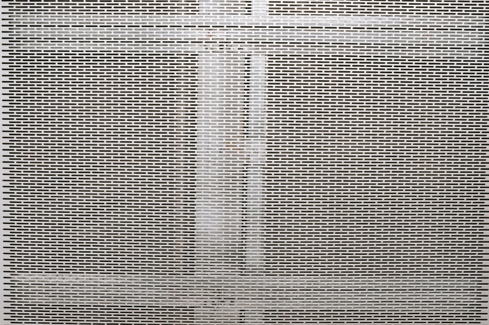
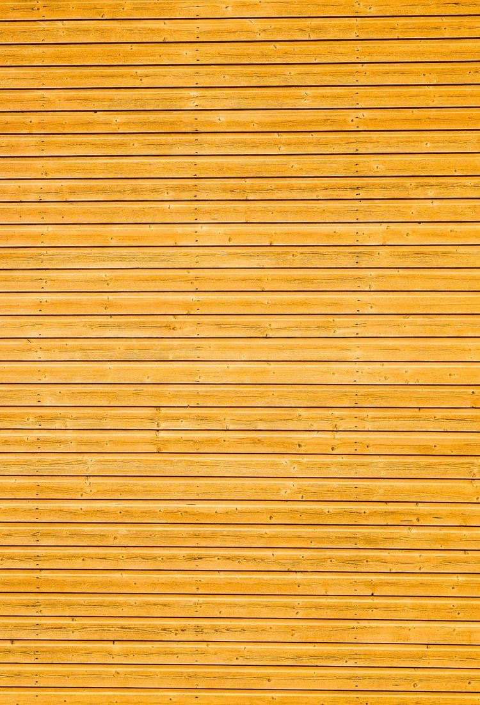
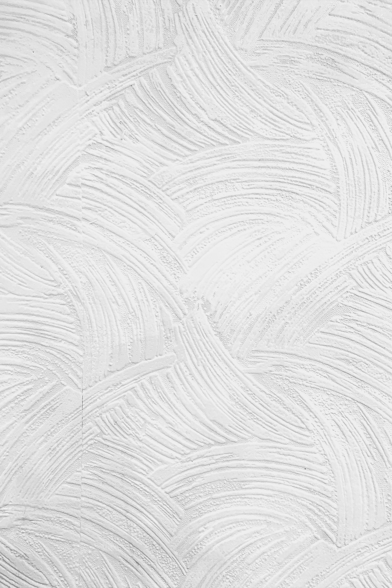
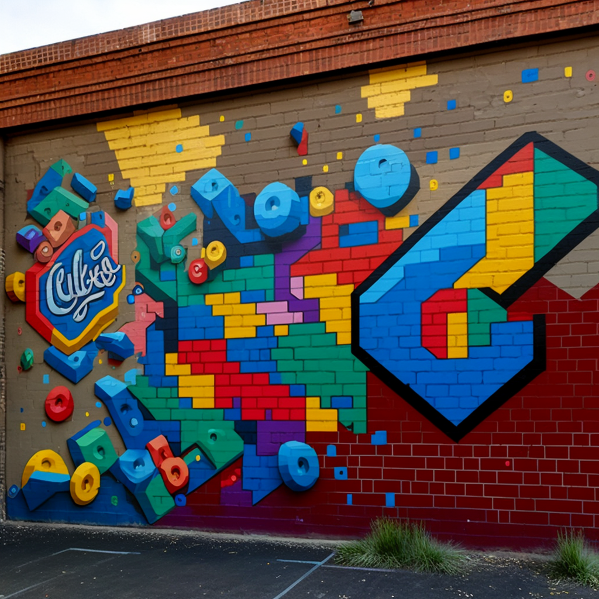
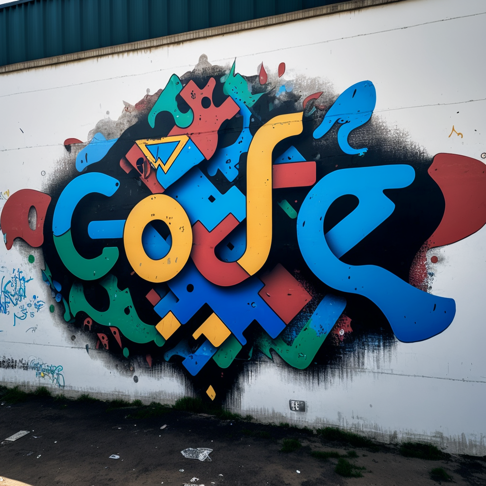
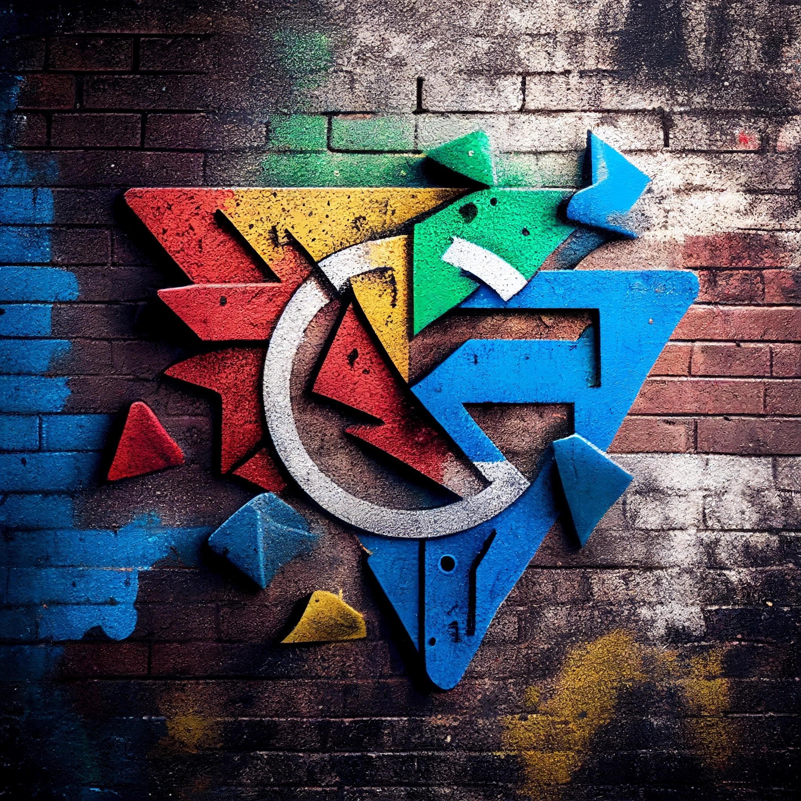

<div align="center">



<br/>

[](https://flutter.dev/)
[](https://dart.dev/)
[](https://flame-engine.org/)
[](https://pub.dev/packages/flame_forge2d)
<br/>
[](#-getting-started)
[](https://github.com/HammasT1/Basketball_flutter/actions/workflows/ci.yml)
[](https://github.com/HammasT1/Basketball_flutter/releases)
[](#-contributing)

**A fast, physics-based arcade basketball game for mobile.**<br/>
Swipe to shoot, charge up dunks, chain baskets to catch fire, and spend your points on new balls and courts.

[Features](#-features) · [How to play](#-how-to-play) · [Shop](#-shop) · [Getting started](#-getting-started) · [Project structure](#-project-structure) · [Roadmap](#-roadmap)

</div>


## 🎬 Gameplay at a glance

<div align="center">

</div>

## ✨ Features

<table>
  <tr>
    <td width="50%" valign="top">
      <h3>🕹️ Swipe-to-shoot physics</h3>
      Drag the ball towards the hoop. Every shot is simulated by <b>Forge2D</b> (Box2D), so power and angle really matter, and the ball rattles off the rim like the real thing.
    </td>
    <td width="50%" valign="top">
      <h3>💥 Dunk power-up</h3>
      Make <b>3 swiped baskets</b> to charge the DUNK button. A ring fills as it charges; when it lights up, one tap sends the ball on a guaranteed arc into the net.
    </td>
  </tr>
  <tr>
    <td width="50%" valign="top">
      <h3>🔥 Streaks &amp; On Fire mode</h3>
      Hit <b>3 in a row</b> and you're <b>ON FIRE</b>: every basket is worth <b>double</b>, the ball glows and leaves a trail of embers, until you miss.
    </td>
    <td width="50%" valign="top">
      <h3>🏆 Saved high score</h3>
      Your best score is stored on the device. Beat it and the game-over screen celebrates with a <b>NEW RECORD!</b> banner.
    </td>
  </tr>
  <tr>
    <td width="50%" valign="top">
      <h3>🛒 Shop: skins &amp; courts</h3>
      Every point you score becomes a <b>coin</b>. Spend them on <b>6 ball skins</b> and <b>6 court themes</b>, all saved between sessions.
    </td>
    <td width="50%" valign="top">
      <h3>⏱️ 30-second rounds</h3>
      Race the shot clock on an LED-style scoreboard, with sound effects, background music, a buzzer and animated menus.
    </td>
  </tr>
</table>


## 🎮 How to play

| | Action | How |
|:-:|---|---|
| 👆 | **Shoot** | Swipe the ball upwards towards the hoop. A new ball appears after each shot. |
| 💥 | **Dunk** | When the DUNK button is lit (3/3), tap it for a guaranteed basket. |
| 🔥 | **Catch fire** | Make 3 baskets in a row. Keep the streak alive for double points. |
| 🛒 | **Shop** | After a round, tap **Main Menu / Shop** to spend your coins. |

### Scoring

| Event | Points | Notes |
|---|:-:|---|
| 🏀 Basket | **1** | Swiped shots also charge the dunk meter |
| 🔥 Basket while On Fire | **2** | Starts from your 4th basket in a row |
| 💥 Dunk | **1 / 2** | Counts towards your streak; doesn't recharge the meter |
| ❌ Miss | – | Resets your streak and puts the fire out |
| 🪙 End of round | **+1 coin per point** | Coins are saved for the shop |


## 🛒 Shop

Buying an item equips it right away. You can switch back to anything you own at any time.

<table>
<tr>
<td valign="top" width="50%">

#### 🏀 Ball skins

| | Skin | Price |
|:-:|---|--:|
|  | Classic | Free |
|  | Ice | 🪙 25 |
|  | Toxic | 🪙 50 |
|  | Royal | 🪙 75 |
|  | Crimson | 🪙 100 |
|  | Gold | 🪙 150 |

</td>
<td valign="top" width="50%">

#### 🏟️ Court themes

| | Court | Price |
|:-:|---|--:|
|  | Steel Cage | Free |
|  | Hardwood | 🪙 30 |
|  | Studio | 🪙 60 |
|  | Brick Wall | 🪙 90 |
|  | Street Art | 🪙 120 |
|  | Urban Night | 🪙 200 |

</td>
</tr>
</table>

> [!TIP]
> Prices and items live in [`lib/shop/shop_catalog.dart`](lib/shop/shop_catalog.dart). Adding a new skin is one entry: give it a name, a price and a tint color.


## 📸 Screenshots

_Coming soon!_


## 🚀 Getting started

### Prerequisites

- [Flutter SDK](https://docs.flutter.dev/get-started/install) (stable channel; tested with Flutter 3.47)
- An Android/iOS emulator, a connected device, or Chrome for the web build

> [!NOTE]
> The Android project is already configured for current Flutter toolchains (Gradle 8.14, Android Gradle Plugin 8.11, Kotlin 2.3), so it builds without any manual Gradle changes.

### Run it

```bash
# 1. Clone the repository
git clone https://github.com/HammasT1/Basketball_flutter.git
cd Basketball_flutter

# 2. Install dependencies
flutter pub get

# 3. Run on a connected device or emulator
flutter run
```

Pick a specific target with:

```bash
flutter devices
flutter run -d <device-id>     # e.g. flutter run -d chrome
```


## 🗂️ Project structure

```text
lib/
├── main.dart                     # App entry point
├── game/
│   └── basketball_game.dart      # Game loop, timer, scoring, streaks, dunk meter
├── components/                   # Flame / Forge2D components
│   ├── ball.dart                 #   Ball physics, shot & miss detection, fire effects
│   ├── rim.dart  backboard.dart  #   Hoop collision bodies and sprites
│   ├── boundary.dart             #   Walls and floor
│   └── mural_component.dart      #   Court background (equipped theme)
├── screens/
│   ├── splash.dart
│   ├── menu/                     # Main menu and game-over screen
│   └── shop/                     # Shop UI
├── shop/shop_catalog.dart        # Ball skins and court themes, with prices
├── services/                     # Saved data (high score, coins, unlocks)
├── widgets/scoreboard.dart       # LED scoreboard, streak badge, dunk button
└── constants/                    # Image and audio asset names
```

## 🛠️ Built with

| | |
|---|---|
| [Flutter](https://flutter.dev/) | UI toolkit and menus |
| [Flame](https://flame-engine.org/) | 2D game engine: game loop, sprites, particles, effects |
| [Forge2D](https://pub.dev/packages/flame_forge2d) | Box2D physics for the ball and hoop |
| [flame_audio](https://pub.dev/packages/flame_audio) | Sound effects and background music |
| [shared_preferences](https://pub.dev/packages/shared_preferences) | Saving high score, coins and unlocks |
| [flutter_animate](https://pub.dev/packages/flutter_animate) · [lottie](https://pub.dev/packages/lottie) | UI animations |


## 🗺️ Roadmap

- [x] Dunk power-up with charge meter
- [x] Saved high score
- [x] Streaks and On Fire mode
- [x] Shop with coins, ball skins and court themes
- [ ] Swish vs. rim bonus with floating score text
- [ ] Pause and mute buttons
- [ ] Moving hoop at higher scores
- [ ] Game modes: Arcade (lives) and Practice (no timer)
- [ ] Screenshots and gameplay recording

## 🤝 Contributing

Contributions are welcome! To contribute:

1. **Fork** this repository
2. **Create a branch** for your feature or fix
   ```bash
   git checkout -b feature/your-feature-name
   ```
3. **Commit** your changes with a clear message
   ```bash
   git commit -m "Add: short description of your change"
   ```
4. **Push** to your fork
   ```bash
   git push origin feature/your-feature-name
   ```
5. **Open a Pull Request** describing what you changed and why

Please make sure `flutter analyze` passes before opening a PR.

## 📄 License

This project currently has no license file. Contact the repository owner for usage terms.


<div align="center">

**Built with 🧡 using Flutter &amp; Flame**

⭐ If you enjoyed the game, consider starring the repo!

</div>
